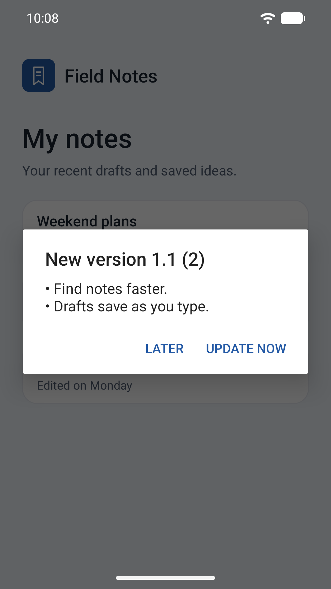
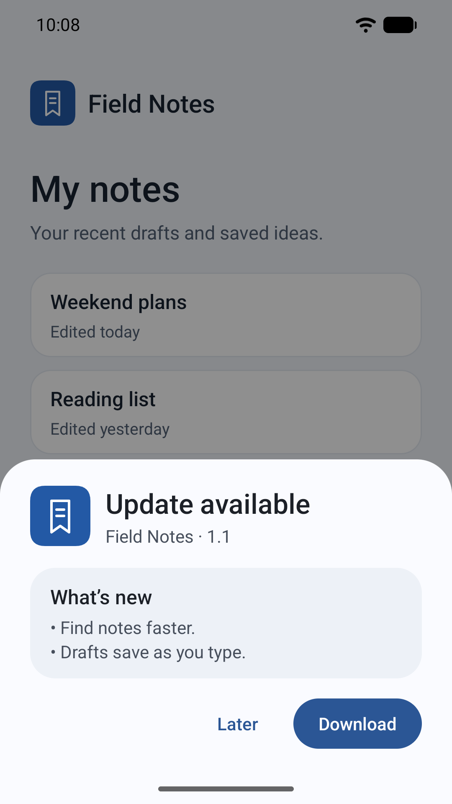

# Zealot Android SDK

| Stable update dialog | In-app update sheet preview |
| :---: | :---: |
|  |  |

## Install

**Stable version [v0.3.1](https://github.com/tryzealot/zealot-android/releases/tag/v0.3.1)** · Android API 21+ · `compileSdk` 37+

Add JitPack inside `dependencyResolutionManagement.repositories` in
`settings.gradle.kts`.

```kotlin
maven("https://jitpack.io")
```

Add the SDK to your app module's `build.gradle.kts`.

```kotlin
dependencies {
    implementation("com.github.tryzealot:zealot-android:v0.3.1")
}
```

## Quickstart

Add internet permission inside `<manifest>` in your app's
`AndroidManifest.xml`.

```xml
<uses-permission android:name="android.permission.INTERNET" />
```

Import `im.ews.zealot.Zealot` and call this from your Activity's `onCreate()`
after `super.onCreate(savedInstanceState)`.

```kotlin
Zealot.create(this)
    .setEndpoint("https://zealot.example.com")
    .setChannelKey("your-channel-key")
    .checkAndShowUpdate()
```

Use your server's base URL and the **Channel KEY** from its Android channel.
To see the dialog, run an older build of the same app and publish a build with
a higher `versionCode` to that channel.

## Documentation

| Guide | What it covers |
| --- | --- |
| [Integration](documentation/integration.md) | Groovy, Java, Flutter, variants, callbacks, and troubleshooting |
| [Automatic and in-app updates](documentation/automatic-updates.md) | Development preview of background downloads and the update sheet |
| [Customization](documentation/customization.md) | Dialog options, custom UI, colors, fonts, and languages |
| [Upgrade guide](documentation/migration.md) | Compatibility, migration from 0.2.0, and switching from a fork |
| [Development](documentation/development.md) | Run the sample, test, and verify a published build |
| [Releases](https://github.com/tryzealot/zealot-android/releases) | Stable versions and release notes |
